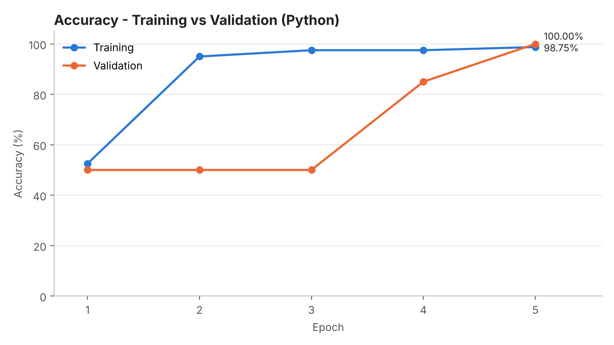
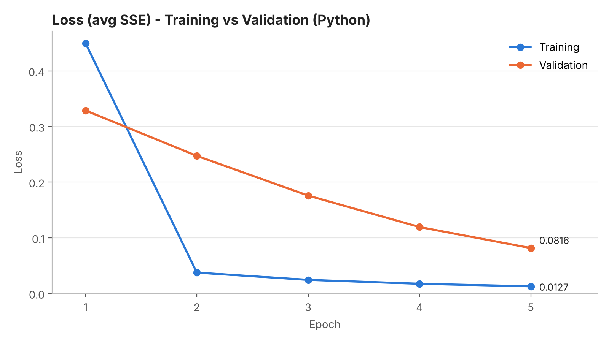

# Single Layer Perceptron — Binary Classification of Iris Data

Assignment 1 — Single Layer Perceptron (SLP).
All code is in one notebook, **`slp_iris.ipynb`**. The SLP is implemented **from scratch in pure Python,
without any library** (no `import` in the SLP cells) and reproduces exactly the same computation as the
Google Sheet. `matplotlib` is used only in the last section, to draw the charts.

Google Sheet: https://docs.google.com/spreadsheets/d/13UpadVSyDkZvNxCDS8hpxpc--3WpCF5_3AXZDE8L1A4/edit

## Problem
Binary classification of the Iris dataset: **Iris-setosa = 0**, **Iris-versicolor = 1**,
using the four features (sepal length, sepal width, petal length, petal width).

| Setting | Value |
|---|---|
| Training data | 80 rows (first 40 setosa + first 40 versicolor) |
| Validation data | 20 rows (last 10 setosa + last 10 versicolor) |
| Initial bias & teta1–teta4 | 0.5 |
| Learning rate | 0.1 |
| Epochs | 5 |
| Activation | Sigmoid, g(z) = 1 / (1 + e^-z) |
| Prediction | 1 if g(z) > 0.5 else 0 |
| Loss | Sum Square Error (g(z) − target)², averaged per epoch |
| Update | Stochastic (after every row): teta = teta − lr · 2(g − t)(1 − g)g · x |

Validation uses the bias and teta obtained at the end of each training epoch.

## Results

| Epoch | Train Loss | Train Acc | Val Loss | Val Acc |
|---|---|---|---|---|
| 1 | 0.449889 | 52.50% | 0.328951 | 50.00% |
| 2 | 0.037452 | 95.00% | 0.247289 | 50.00% |
| 3 | 0.024372 | 97.50% | 0.175892 | 50.00% |
| 4 | 0.017357 | 97.50% | 0.119381 | 85.00% |
| 5 | 0.012740 | 98.75% | 0.081581 | 100.00% |

These values are identical to the Google Sheet results.

## How to run
Open `slp_iris.ipynb` in Jupyter Notebook, JupyterLab, VS Code or Google Colab and run all cells
(Run All). Keep `iris_binary.csv` in the same folder as the notebook; in Colab, upload it first.
Only the chart section needs `matplotlib`.

## Files
- `slp_iris.ipynb` — SLP implementation (no library) + training, validation and charts
- `iris_binary.csv` — 100 rows of Iris data (setosa & versicolor)
- `results.csv` — loss & accuracy per epoch (written by the notebook)
- `accuracy_chart.png`, `loss_chart.png` — charts (written by the notebook)
